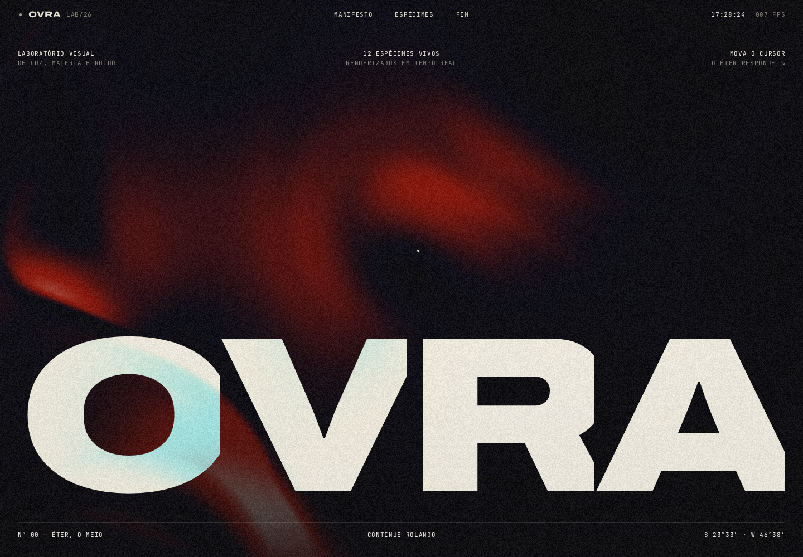
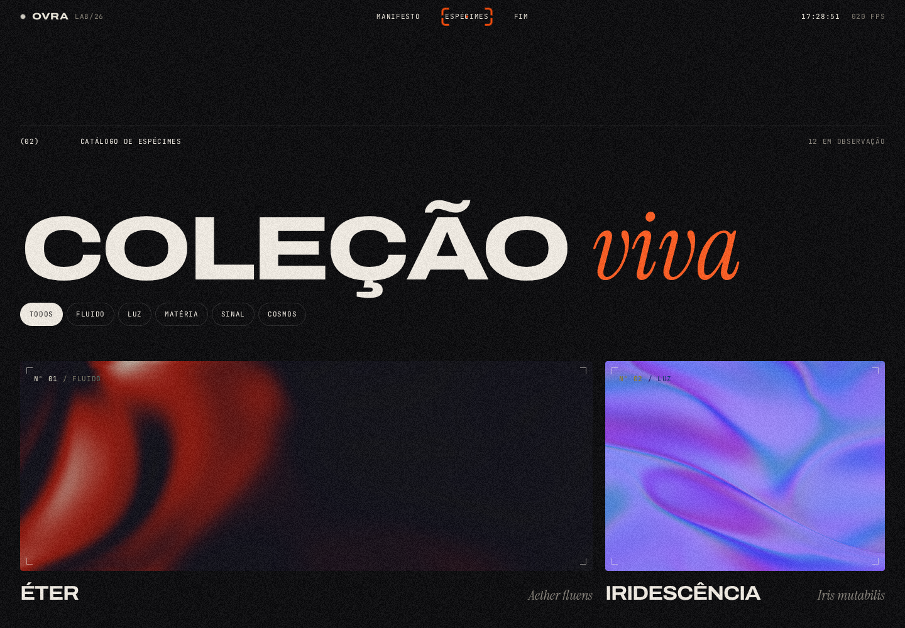
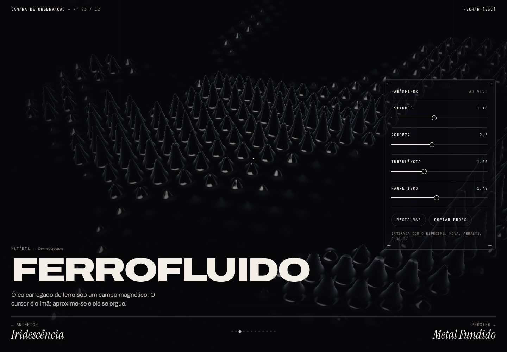
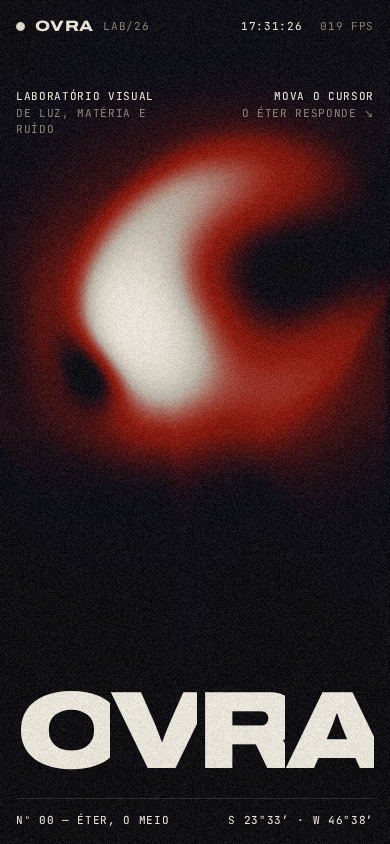

# OVRA — Laboratório Visual

Um laboratório interativo de luz, matéria e ruído. Doze espécimes renderizados em tempo real com shaders GLSL, organizados em cinco famílias e abertos à experimentação.



## A experiência

- **Éter interativo na abertura:** uma simulação de fluido que responde ao movimento do cursor.
- **Catálogo vivo:** prévias animadas com filtros por família.
- **Câmara de observação:** cada espécime ocupa a tela e oferece quatro parâmetros ajustáveis em tempo real.
- **Experimente e copie:** restaure os valores iniciais ou copie os parâmetros atuais em JSON. Os ajustes são preservados ao navegar entre espécimes enquanto a câmara estiver aberta.
- **Interface responsiva:** composição adaptada para desktop e celular, com animações, rolagem suave e cursor personalizado em dispositivos com ponteiro preciso.

### Catálogo



| Família | Espécimes |
| --- | --- |
| Fluido | Éter · Vórtice |
| Luz | Iridescência · Véu · Prisma · Pilar |
| Matéria | Ferrofluido · Metal Fundido |
| Sinal | Terminal · Poeira |
| Cosmos | Topografia · Galáxia |

### Câmara de observação

Abra um cartão para explorar seu efeito, ajustar os controles e navegar pela coleção.



| Ação | Como usar |
| --- | --- |
| Interagir com o efeito | Mova, arraste ou clique; a resposta depende do espécime |
| Alterar parâmetros | Use os controles do painel |
| Trocar de espécime | Botões Anterior/Próximo ou teclas `←` / `→` |
| Restaurar parâmetros | Botão **Restaurar** |
| Copiar os parâmetros em JSON | Botão **Copiar props**; requer acesso à área de transferência |
| Fechar a câmara | Botão **Fechar** ou tecla `Esc` |

### No celular



As imagens são capturas da aplicação. Os efeitos são renderizados pelo navegador, sem vídeos pré-gravados.

## Executar localmente

Requisitos: **Node.js 22.12 ou superior**, npm e um navegador com suporte a **WebGL 2**. O Éter também requer `EXT_color_buffer_float` ou `EXT_color_buffer_half_float`.

```bash
npm ci
npm run dev
```

Acesse `http://localhost:5173/ovra/` na configuração padrão. Caso a porta esteja ocupada, use o endereço informado pelo Vite.

As fontes Archivo, Instrument Serif e JetBrains Mono são carregadas pelo Google Fonts e dependem de conexão com a internet.

## Comandos

| Comando | Finalidade |
| --- | --- |
| `npm run dev` | Inicia o servidor de desenvolvimento |
| `npm run lint` | Executa o ESLint |
| `npm run build` | Verifica os tipos e gera o site em `dist/` |
| `npm run preview` | Serve o build de produção localmente |

O ESLint verifica a aplicação e sua configuração; `src/components/` é excluído por conter componentes do registro React Bits. O build também verifica os tipos desses componentes.

## Tecnologias

- **React 19 + TypeScript** para a interface e os controles.
- **Vite 8** para desenvolvimento e build.
- **WebGL 2 + GLSL** para os efeitos, com acesso direto à API do navegador.
- **GSAP + ScrollTrigger** para transições e animações ligadas à rolagem.
- **Lenis** para rolagem suave e **Motion** para efeitos de texto.
- **React Bits** como origem dos componentes visuais registrados em `components.json`.

Os shaders e a câmara usam carregamento sob demanda. As prévias são montadas apenas perto da área visível e suspensas quando a câmara abre, reduzindo a quantidade de contextos WebGL ativos.

## Estrutura

```text
src/
├── App.tsx             # Composição da página e estado da câmara
├── main.tsx            # Entrada da aplicação
├── components/         # Shaders, cursor e efeitos visuais
├── lab/
│   ├── Hero.tsx        # Abertura, cabeçalho e indicadores
│   ├── Manifesto.tsx   # Apresentação do laboratório
│   ├── Catalogue.tsx   # Catálogo e filtros por família
│   ├── Chamber.tsx     # Observação e ajuste de parâmetros
│   ├── specimens.tsx   # Definições, controles e valores iniciais
│   ├── primitives.tsx  # Montagem das prévias e elementos compartilhados
│   ├── hooks.ts        # Preferência de movimento, relógio e FPS
│   ├── Loader.tsx      # Sequência de entrada
│   └── Footer.tsx      # Encerramento e retorno ao topo
└── styles/global.css   # Estilos e adaptações de layout
images/                 # Capturas utilizadas neste README
public/icons/           # Ícone do projeto
```

## Publicação

O workflow [deploy.yml](.github/workflows/deploy.yml) instala as dependências, executa o lint, gera o build e publica `dist/` no GitHub Pages. Ele é acionado por pushes em `main` ou manualmente pelo GitHub Actions. O repositório deve usar **GitHub Actions** como origem do Pages.

O caminho base padrão é `/ovra/`, definido em [vite.config.ts](vite.config.ts). Para hospedar na raiz de um domínio:

```bash
VITE_BASE_PATH=/ npm run build
```

Para outro subdiretório, substitua `/` pelo caminho desejado, incluindo a barra final. A mesma variável pode ser usada com `npm run dev`.
