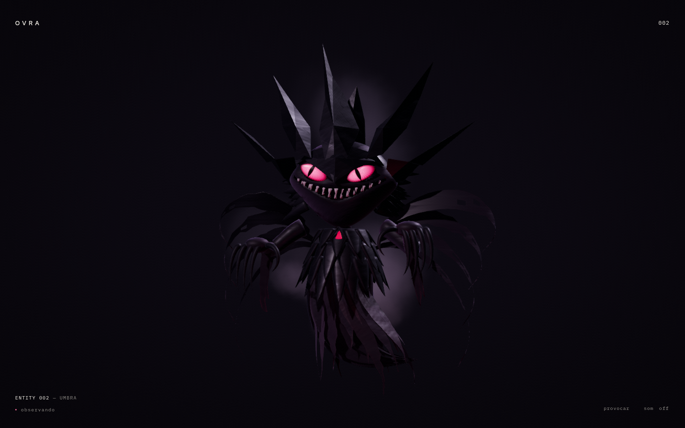

# OVRA

Um laboratório pessoal de experiências visuais interativas em tempo real. O foco atual é **ENTITY 002 — UMBRA**: uma criatura de sombra que observa, hesita e reage ao visitante.

[Experiência publicada](https://gustavomfg.github.io/ovra/) · [Direção visual](DESIGN.md) · [Personagem e implementação](docs/entity-002.md)



UMBRA flutua no vazio. A máscara angular continua em uma coroa de lâminas, olhos magenta revelam pupilas estreitas e a matéria se prolonga em garras e camadas rasgadas. A abertura de 9,2 segundos revela o olhar antes do corpo. Aproxime o cursor com calma para despertar curiosidade; movimentos rápidos acumulam aversão. Clique ou use `provocar` para uma resposta discreta. O som é opcional.

O personagem é uma interpretação 3D da imagem de referência fornecida pelo autor. ENTITY 001 foi retirado da implementação e dos assets ativos; seu histórico permanece no Git.

## Executar localmente

```bash
npm ci
npm run dev
```

Abra `/ovra/`. O mesmo base path é utilizado no GitHub Pages; `VITE_BASE_PATH` permite outra publicação.

```bash
npm run lint      # ESLint
npm test          # Vitest: lógica, montagem e ciclo de vida
npm run build     # TypeScript e produção
npm run test:pwa  # build e verificação offline no Chromium
npm run preview   # serve o build
```

## Organização

```text
src/app/                        shell discreto e roteamento por hash
src/core/                       câmera, molas, loop, áudio, cache e acabamento
src/experiments/registry.ts      somente ENTITY 002, carregado sob demanda
src/experiments/entity-002/      personagem, percepção, temperamento e cena
public/3d/entity-002/            GLB cinematic/optimized e poster do modo essencial
assets/source/entity-002/        Blender editável, referência e mapas PBR
tools/blender/entity-002/        construção reproduzível e validação dos GLB
docs/entity-002.md              direção, comportamento e decisões técnicas
```

React, TypeScript, Three.js, GSAP e Vite. A geometria e os materiais vêm do Blender; olhar, garras, tecido, iluminação e câmera são animados no navegador. Sem novas dependências npm.

## Assets

```bash
blender -b --factory-startup --python tools/blender/entity-002/build_umbra.py -- cinematic optimized
python3 tools/blender/entity-002/validate_asset.py
```

As duas qualidades compartilham controles e identidade. Mapas de normal e rugosidade são incorporados aos modelos. Cada instância possui suas geometrias e materiais; as texturas do cache são compartilhadas. Backups `.blend1` e bytecode Python ficam fora do Git.

## Cuidado técnico

Movimento reduzido respeitado, renderização pausada com a aba oculta ou fora da tela, áudio desligado por padrão, controles por teclado e fallback após falha de modelo ou WebGL. O modo essencial usa uma captura do próprio personagem; olhos e sorriso em canvas continuam disponíveis se a imagem falhar.

O PWA preserva o shell e os assets pequenos offline. GLB são armazenados quando buscados, sem baixar antecipadamente duas qualidades de modelo. Pushes para `main` executam lint, testes, build, verificação offline e publicação via GitHub Actions.

O foco desta etapa é a aparência e o comportamento do personagem. A fidelidade à ilustração é uma interpretação, e não uma reconstrução fotogramétrica.
