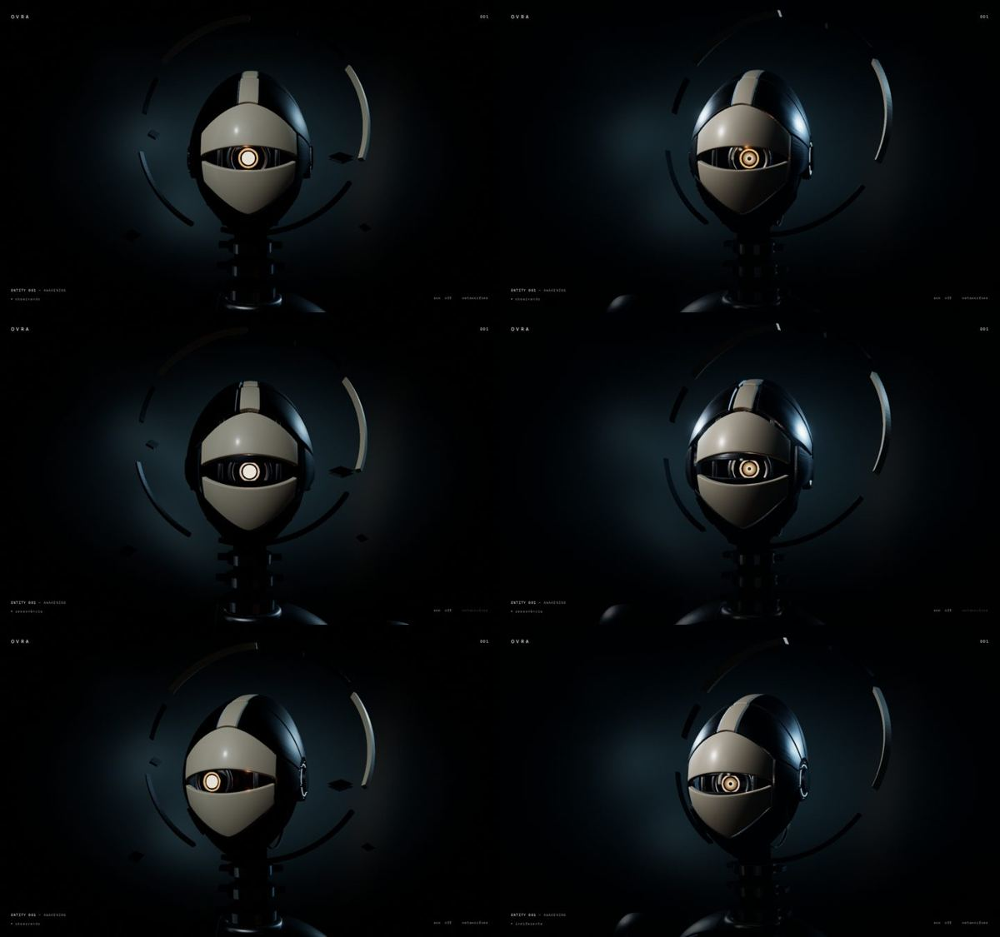
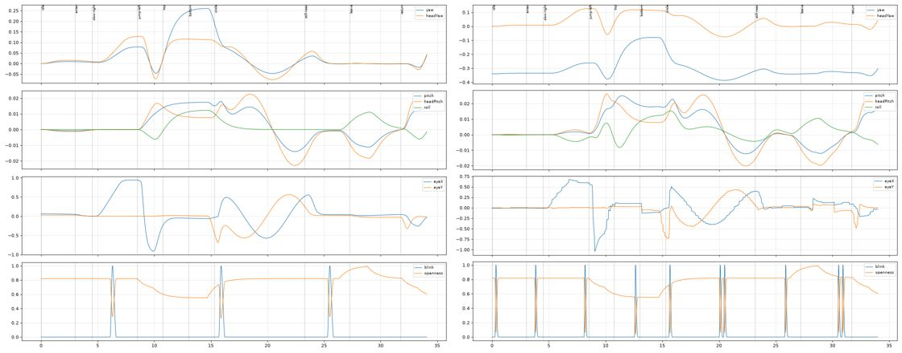

# ENTITY 001 · Pesquisa e passe cinematográfico

Registro da investigação de referências e das mudanças aplicadas ao ENTITY 001 — AWAKENING em 13/10/2026. Cada afirmação técnica é marcada como **[confirmado]** (visto em código, rede, GPU ou medição), **[hipótese]** (inferência plausível sem prova direta) ou **[inspiração]** (direção artística, sem pretensão técnica).

## 1. Estado inicial

Ponto de restauração: tag `entity-001-baseline-2026-10-13` (commit `a272dd8`). O trabalho está no branch `feat/entity-001-cinematic`, sem commits.

- **Arquitetura** [confirmado]: React 19 + Three.js r186. `scene.ts` monta renderer, câmera com molas críticas (`core/camera.ts`), ambiente PMREM de softboxes (`core/lighting.ts`), bloom + FXAA + acabamento (`core/postprocessing.ts`) e o personagem Blender (`character.ts`), com fallback procedural (`kernel.ts`/`shards.ts`) e 2D (`EntityFallback.tsx`). O temperamento (`behavior.ts`) tem 7 humores; a percepção (`perception.ts`) usa memória visual de 0,24–0,32 s, molas e piscada periódica a cada 9,6 s.
- **Assets** [confirmado]: GLBs gerados por um pipeline Python reproduzível (`tools/blender/entity-001/`), 67 primitivas, 158 824 triângulos (cinematic) / 34 628 (optimized), 5 clipes.
- **Verificações**: lint, 68 testes Vitest e build passavam.
- **Frame** [confirmado, Spector.js]: 495 comandos, 81 draws, 16 clears, 18 programas, nenhum erro GL. A sequência é: fundo → ~60 draws do modelo → poeira (420 pontos) → 3 anéis → 16 passes de tela cheia (bloom em 5 mips, output, FXAA, acabamento).
- **Desempenho** [confirmado]: 60 fps estáveis (vsync) tanto na RTX 4060 quanto na iGPU AMD Renoir, 1440×900.

### Problemas encontrados

1. **Titânio que parecia plástico preto** [confirmado]: `M_Titanium` era metálico com cor base `#23272d` (~0,02 linear). Num metal a cor base é a refletância F0; 2 % não segura reflexo nenhum. Titânio real fica perto de 0,5.
2. **Luz frontal chapada**: key frontal e softbox grande à frente geravam uma mancha de brilho no centro da cerâmica e achatavam o volume.
3. **Olho como adesivo**: a pupila era um disco emissivo branco uniforme; depois do tone mapping virava um círculo sem estrutura.
4. **Enquadramento simétrico e frontal**: o halo era um círculo plano e o corpo cortado na base pesava no quadro.
5. **Piscada que não fechava** [confirmado, medição]: a mola das pálpebras (rigidez 64) atenuava a piscada de 0,1 s; a abertura mínima era 0,26, nunca um olho fechado.
6. **Detalhes sem função**: quatro octaedros soltos (`FRAG_01..04`) liam como detritos.

## 2. Ferramentas e limitações

- **Chromium headless com GPU real** [confirmado]: com `--use-angle=vulkan` o Chromium do Playwright usa a RTX 4060; com `--use-angle=gl-egl`, a iGPU AMD Renoir, que serve de máquina intermediária. Medições de desempenho só foram feitas nessas duas, nunca em SwiftShader.
- **Spector.js MCP**: roda em SwiftShader. Uma captura do nosso frame levou vários minutos. Os erros "Canvas has an existing context of a different type" e `getTranslatedShaderSource` vieram da própria instrumentação do Spector; a execução sem Spector não registrou erros.
- **REA**: `analyze_web_bundle` sobre o Synthetic Humans (bundle Astro de 914 KB; materiais nomeados `shadow`, `card` e `points`; `fboHelper`).
- **Instrumentação própria**: um init script envolve `getContext` para contar draws, programas e texturas por frame e registrar os primeiros caracteres de cada shader.
- **Codrops**: a demo e o artigo retornam 403 (Cloudflare) para o navegador automatizado e para o fetch. O código do tutorial foi lido num espelho público no GitHub (`sandeep-admin/Interactive3DCharacter`, `js/script.js`).
- **Ghidra**: não foi usado; nenhuma referência tem binário ou WASM relevante.

## 3. Referências

### 01 — Splattie (splattie.app)

- **Representação** [confirmado, README e bundle do widget MIT `@afromero/splattie-widget@0.3.3`]: Gaussian splats (Spark 2.0) com rig FLAME (cabeças, 5 ossos), SMPL-X (corpos) ou esqueleto genérico, skinning por quaternions duais e blendshapes FLAME escritos no buffer de splats.
- **Olhar** [confirmado, constantes no bundle]: `smoothingTau: 0.18`, `deadzone: 0.06` e limites separados para olho (`maxEyeYaw 0.09`, `maxEyePitch 0.04`) e pescoço (`maxNeckYaw 0.08`, `maxNeckPitch 0.05`). **Microssacadas**: amplitude 0,04, intervalo de 600–1800 ms, movimento de 35 ms. Piscada automática com intervalo aleatório. Cada estado (`idle`, `hover`, `click`) tem a sua câmera e o seu "ghost" (flutuação).
- **Limitação de ângulo** [hipótese]: o splat vem de uma única imagem, então limites pequenos de rotação escondem a falta de informação lateral. A ilusão depende de nunca girar muito.
- **Para o OVRA**: separar olho e cabeça e fazer microssacadas de verdade custa quase nada e dá muita vida.

### 02 — Needle Engine, look-at-cursor header

- **Pilha** [confirmado]: Needle Engine 4.12 (exportado do Unity 2021.3), three r169, num iframe `*.needle.run`. Cerca de 16 draws por frame, 10 programas, 47 texturas.
- **Implementação** [confirmado, código-fonte do pacote `@needle-tools/engine`]: `CursorFollow` converte o ponteiro da **página inteira** em NDC, faz `unproject` e posiciona um alvo a uma distância fixa da câmera, suavizado por `lerp(dt / damping)`. `LookAt` aplica `lookAtObject(target)` direto, **sem limites nem amortecimento**. Toda a suavidade vem do alvo.
- **Para o OVRA**: o cursor fora do canvas continua valendo (página inteira), o que é bom para cabeçalhos. O `lookAt` duro é exatamente o que não queremos: a cabeça vira como uma ferramenta.

### 03 — Codrops, Interactive 3D Character (2019)

- [confirmado, código do tutorial] Os ossos `neck` e `waist` são escritos direto no `mousemove` com limites de 50° e 30° (para cima, só metade). As faixas de animação desses ossos são **removidas dos clipes** (`tracks.splice`) para o cursor ter posse exclusiva. Clique por raycast escolhe um clipe aleatório com `crossFadeTo` de 0,25 s. Não há amortecimento: a pose salta quando o cursor entra e congela quando sai.
- **Para o OVRA**: a distribuição pescoço/cintura e a posse exclusiva dos canais já existiam aqui (`LIVE_CHANNELS`). O que faltava era o tempo entre olho, cabeça e corpo.

### 04 — Synthetic Humans (Lusion)

- **Pilha** [confirmado]: three r148, WebGL2 sem antialias nativo, cerca de 106 draws por frame, 24 programas, 228 texturas. Formato binário próprio (`SCENE.buf`, `CAMERA.buf`, `ANIMATIONS.buf`, `POINTS.buf`).
- **Acabamento** [confirmado, fontes dos shaders]: profundidade de campo por buffer de profundidade (`u_focusDistance`, kernel de disco de 16 amostras em baixa qualidade), blur gaussiano com raios 3/5/7/9/11, bloom com limiar e halo, gradiente de cor, vinheta e **channel mixer** (gradação por matriz). O material humano é um **matcap HDR** (`matcap.exr`, 702 KB), não PBR.
- **Truques de custo** [confirmado, rede]: a multidão de fundo é feita de **cards impostores** (`card_*_beauty.webp` com `card_*_alpha.webp`, cerca de 16 KB cada), e as sombras de contato são **texturas pré-renderizadas** (`shadow_*.webp`, cerca de 3 KB) em planos.
- **O que separa o correto do premium** [inspiração]: paleta monocromática disciplinada, profundidade de campo forte separando camadas, sombras de contato macias e nenhum detalhe competindo com o sujeito. Quase tudo que parece caro foi pré-calculado.

### 05 — Angelos Giovanis (experimental)

- **Dionysos** [confirmado, código da página]: three r160, GLB com meshopt de 496 KB, `RoomEnvironment` via PMREM, ACES com exposição 1,05. Luz: hemisférica baixa (0,30) "para mais contraste", key rasante branca (2,0), **rim frio mais forte que a key** (2,6, `#8fb4ff`) e fill quente fraco. Interação: `ease` de 0,07 por frame (dependente da taxa de quadros), limites de 0,6 rad de yaw e 0,28 de pitch, balanço "de toca-discos" depois de 2,2 s parado, flutuação senoidal e paralaxe de câmera. Um único draw por frame.
- **Little Guy** [confirmado]: **sem WebGL**. São 48 quadros reais (`turn_001..048`, cerca de 62 KB cada) desenhados em canvas 2D. O cursor escolhe o quadro, com crossfade entre os dois vizinhos e espelhamento para o outro lado; uma faixa central de crossfade esconde a troca de lado. Olhar com mola (`STIFF 90 / DAMP 19`, quase crítica), zona morta de 0,03, olhares espontâneos a cada 3–7 s (±0,16) e respiração em escala (0,006 a 0,2 Hz).
- **Para o OVRA**: a mesma economia vale para nós. Uma luz bem posta e um olhar com hesitação contam mais que geometria. O espelhamento de quadros só serve a personagens simétricos e a ângulos curtos.

## 4. Comparação de abordagens de olhar

| Abordagem | Exemplo | Custo | Naturalidade | Limite |
| --- | --- | --- | --- | --- |
| Escrita direta no osso | Codrops | mínimo | baixa (salta, congela) | sem inércia |
| Alvo suavizado + `lookAt` | Needle | mínimo | média (gira como ferramenta) | sem limites nem hierarquia |
| Mola em rotação | Dionysos, baseline OVRA | mínimo | boa | olho e cabeça se movem juntos |
| Quadros reais | Little Guy | rede (cerca de 3 MB) | fotográfica | ângulos fixos, sem 3D |
| Olho em sacadas + cabeça segue a fixação | Splattie (parcial), OVRA agora | mínimo | alta | precisa de tuning por humor |

## 5. O que mudou no OVRA

### Fase A — Design e presença

- **Materiais fisicamente plausíveis**, corrigidos na fonte (`common.py`) e com os GLBs regenerados: titânio `#545a63` (F0 ≈ 0,1) com rugosidade 0,38, aço escovado `#a4a9b0`, cerâmica neutra `#cfcac0` com coat 0,55 / 0,24 e lente com rugosidade 0,06. Antes de regenerar, a reprodutibilidade foi testada no worktree do baseline: a saída era estruturalmente idêntica à commitada.
- **Variação procedural de rugosidade** (`lookdev.ts`): ruído em espaço de objeto, sem UVs (metade das primitivas não tem UV), com 14–22 % de amplitude. Simula marcas de manuseio e acabamento irregular.
- **Olho reconstruído como sensor**: shader na pupila com abertura escura que dilata, borda quente, fibras radiais emissivas e queda para âmbar. Uma **córnea** de vidro aditivo (só reflexo, IOR 2,3) recebe o catchlight de uma "eye light" a cerca de 40° do eixo, posicionada sobre o vidro escuro (sobre a pupila o brilho desaparece).
- **Pose 3/4**: o corpo gira −0,34 rad em direção à key. O pescoço devolve 62 % e o olho o resto, então a entidade fica de três quartos mas **encara o visitante**. O halo vira uma elipse com profundidade. No celular o giro é de 55 %.
- **Fragmentos soltos ocultados** na web (os nós continuam no GLB, então os clipes não mudam).

### Fase B — Movimento (`perception.ts`)

- **Coordenação olho–cabeça**: o olho faz **sacadas min-jerk** (30–120 ms, ficando um pouco aquém do alvo com correção) e **perseguição suave** de alvos lentos; durante a fixação, **microssacadas** de 0,012–0,032 a cada 0,6–1,8 s. A cabeça segue a **fixação**, não o cursor, então o olho sempre conduz. Quando a cabeça chega, o olho volta para o centro da órbita.
- **Piscadas**: estocásticas e dependentes do humor (curiosa pisca menos, alerta mais), fechamento rápido e abertura lenta, 12 % de piscada dupla e **piscada evocada** em mudanças grandes de olhar (comum em pessoas e animais). As pálpebras ficaram rápidas o bastante (rigidez 420) para a piscada fechar de fato.
- **Atenção ociosa**: pontos escolhidos e mantidos por 1,6–4,2 s no lugar de senoides. Quando o visitante sai, o olhar fica onde ele estava por cerca de 0,5–1 s e depois relaxa.
- **Arcos**: giros rápidos baixam um pouco a cabeça e inclinam para dentro da curva.
- **Pupila**: dilata na curiosidade e no devaneio e contrai no alarme.
- Todo o sorteio usa um PRNG com semente (`createRandom`), o que mantém testes determinísticos.

### Fase C — Cinematografia

- **Luz**: key lateral alta como **SpotLight** (o pescoço cai no vazio), dois rims frios e softboxes em **tiras longas**, que desenham linhas de brilho em vez de uma mancha.
- **Lente**: 28° no lugar de 34°, com distâncias reescaladas (16,2 de base, mínimo de 15,3). Achata menos o ovo e separa o halo do crânio.
- **Gradação** no passe de acabamento (sem passes extras): curva S leve, sombra levemente fria e queda de luz na base do quadro, para o corpo se dissolver. Exposição em 1,04.
- **Testado e rejeitado**: GTAO (oclusão ambiente em tela). A diferença média foi de 0,44/255 nesta luz, pequena demais para pagar uma renderização extra da cena por frame.

### Fase D — Desempenho

| Medição (1920×1080, sem vsync) | Antes | Depois |
| --- | --- | --- |
| iGPU AMD Renoir, fps médio | 360 | 322 (−10 %) |
| RTX 4060, fps médio | 630 | 618 (−2 %) |
| Draws por frame | 81 | 78 |
| Programas | 26 | 30 |

Com vsync, as duas GPUs seguram 60 fps fixos (p99 de 16,8 ms) em desktop e em 390×844. O rAF sem vsync mede sobretudo a submissão; os números valem como **comparação relativa**.

### Movimento medido (mesma coreografia de cursor, 34 s)

| | Antes | Depois |
| --- | --- | --- |
| Tremor da cabeça (RMS do resíduo) | 0,0003 rad | 0,0003 rad |
| Velocidade de pico do olho | 3,9 u/s (mola) | 15,6 u/s (sacada, cerca de 160°/s) |
| Piscadas | 3 | 10 |
| Abertura mínima na piscada | 0,26 | 0,04 |

## 6. Arquivos afetados

- `src/experiments/entity-001/lookdev.ts` (novo) e `lookdev.test.ts` (novo).
- `perception.ts`, `perception.test.ts`, `behavior.ts` (`dilation`), `character.ts` (look-dev, sensor, córnea, `restYaw`, pálpebras), `scene.ts` (luz, softboxes, pose, arcos, sonda dev-only, gradação), `config.ts` (lente, `restYaw`), `choreography.ts` (distâncias relativas).
- `src/core/postprocessing.ts` (`uGrade`, `uFloor`).
- `tools/blender/entity-001/common.py` (materiais) e, regenerados, `public/3d/entity-001/*.glb`, `assets/source/entity-001/entity-001.blend` e os previews `hero`, `eye` e `front`.

## 7. Verificações

- `npm run lint`, `npm test` (74 testes, 6 novos), `npm run build` e `npx playwright test` (PWA offline) passam.
- A sonda de movimento (`window.__ovraProbe`) só existe em desenvolvimento; o bundle de produção não a contém.
- Validação visual com GPU real: abertura, cursor nas quatro bordas e nos cantos, permanência perto do olho (curiosa), flicks rápidos (indiferente), recuperação, saída do cursor e ressonância. Desktop (1440×900) e celular (390×844), sem erros de console.
- `validate_glb.py` aprova os dois GLBs (67 draws, orçamento de triângulos intacto).

## 8. Pendências e próximos passos

1. **Brilho pontual na cerâmica**: a key é uma luz pontual, então o coat mostra um pequeno ponto quente na testa. Uma `RectAreaLight` daria um brilho alongado de softbox, ao custo de LTC por pixel; vale testar na iGPU.
2. **Torso**: continua sendo a parte mais fraca do modelo (já dizia a direção de arte). Hoje ele é escondido pela queda de luz. Um segundo passe no Blender (ombros facetados, colarinho mecânico) permitiria planos mais abertos.
3. **Sombras de contato pré-calculadas** (à moda Lusion): AO por vértice no Blender (atributo `COLOR_0`) e multiplicação no shader daria profundidade entre placas sem custo de runtime. É o caminho barato que o GTAO não justificou.
4. **Profundidade de campo leve** só no halo (ele está atrás do crânio), em meia resolução, para separar as camadas como no Synthetic Humans.
5. **Alinhar o AWAKEN à nova luz**: a abertura ainda usa os tempos antigos de `key`/`rim`; com a SpotLight, a revelação da matéria pode ficar mais lenta e lateral.
6. **Perseguição pelo canvas inteiro**: como no Needle, o olhar poderia continuar valendo com o cursor fora do palco (no topo da página, por exemplo).
