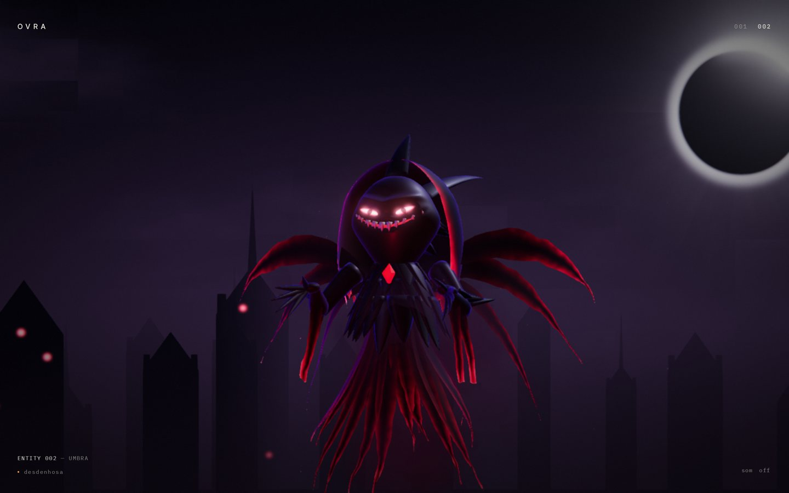
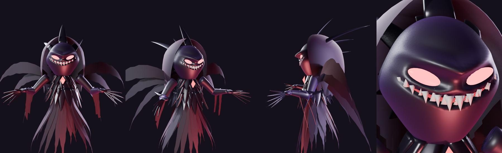
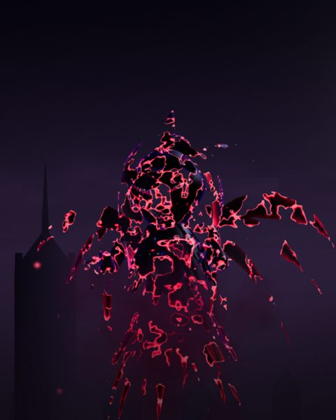
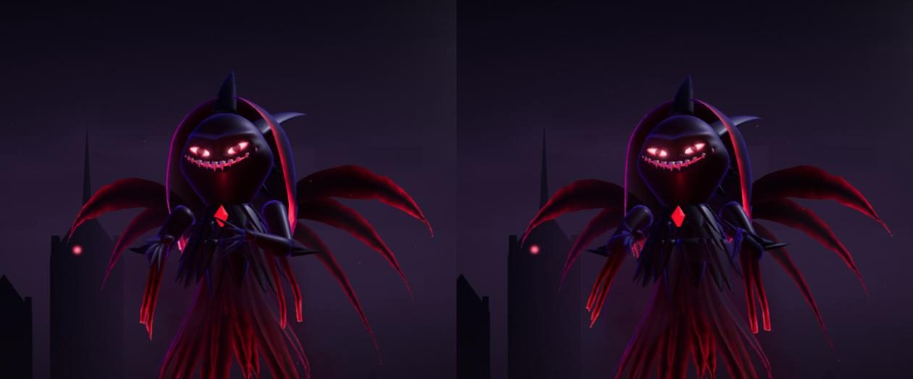

# ENTITY 002 — UMBRA

<p align="center"></p>

Uma criatura de sombra que flutua sobre uma cidade gótica, sob uma lua eclipsada. Ela observa o visitante com olhos em brasa, sorri com presas demais e reage ao modo como é abordada: a calma desperta curiosidade e uma garra se estende; a pressa a faz recuar e abrir os farrapos; o toque a faz rir em silêncio.

## Origem e originalidade

O ponto de partida foi uma ilustração de referência com atmosfera de demônio de sombra: corpo que se desfaz em fumaça e farrapos, olhos carmesim, sorriso predatório, garras, gema no peito, lua eclipsada e ruínas góticas. Essa ilustração é uma releitura evidente de um personagem protegido (Gengar, de Pokémon). Por isso a UMBRA **não reproduz** a sua silhueta: não tem corpo esférico com duas orelhas pontudas nem braços curtos. A identidade dela é própria:

- **Capuz espectral em farrapos** que emoldura o rosto e cai sobre os ombros (arquétipo de ceifador);
- **Chifres de foice** que saem das têmporas e varrem para trás, e uma **crista** de lâminas na linha média;
- crânio alongado em forma de capuz, **sobrancelha em V**, olhos amendoados inclinados com **pupila em fenda**;
- **pescoço e tronco** separados, **peito de escamas-lâmina** com uma gema, **braços longos** com cinco garras e esporões no antebraço;
- metade inferior que nunca termina: **farrapos em forma de chama** e duas **asas-capa rasgadas**.

Nenhuma imagem, textura ou forma da referência entra no projeto. O modelo é gerado por código e o cenário é procedural em shader.

<p align="center"></p>

## Pipeline

| Arquivo | Papel |
| --- | --- |
| `tools/blender/entity-002/build_umbra.py` | Modela a criatura por código (bmesh), cria a hierarquia de controles e exporta os GLB |
| `tools/blender/entity-002/preview_umbra.py` | Renders Eevee de conferência (frente, 3/4, perfil, rosto) |
| `assets/source/entity-002/umbra.blend` | Fonte gerada (cinematic) |
| `public/3d/entity-002/umbra-{cinematic,optimized}.glb` | 775 KB / 382 KB, 22 primitivas, cerca de 40 mil / 19 mil triângulos |

```bash
blender -b --factory-startup --python tools/blender/entity-002/build_umbra.py -- all
blender -b --factory-startup --python tools/blender/entity-002/preview_umbra.py -- /tmp/umbra-previews
```

**Hierarquia**: `UMBRA_ROOT → CTRL_BODY → CTRL_TORSO → CTRL_NECK → CTRL_LOOK → CTRL_HEAD` (crânio, dentes, boca, chifres, capuz, `CTRL_EYE_L/R`), mais `CTRL_SHOULDER → CTRL_ELBOW → CTRL_WRIST` em cada braço e `CTRL_GEM`. Tudo é animado por código; o GLB não traz clipes.

**Cores de vértice** (`COLOR_0`) nos farrapos, no capuz, nas mangas e nas asas: **R** guarda o peso de vento (raiz fixa, ponta livre) e **G** o brilho da borda rasgada. A web lê esse atributo em vez de usá-lo como cor.

## Web (`src/experiments/entity-002/`)

| Módulo | Papel |
| --- | --- |
| `materials.ts` | Injeção nos materiais glTF: materialização por ruído, recorte violeta, vento e brasa nos farrapos (as pontas se desfazem em fumaça), olho com pupila em fenda |
| `creature.ts` | Carregamento, posse de recursos e animação procedural: flutuação, olhar, piscada, braços, sobressalto e riso |
| `backdrop.ts` | Céu, eclipse com coroa, duas camadas de cidade gótica com janelas acesas e névoa (parallax) |
| `smoke.ts` | Fiapos de fumaça instanciados e brasas subindo |
| `direction.ts` | Regras puras: abertura, reação por humor, curva do riso |
| `scene.ts` | Luz (lua fria por trás, brasa carmesim por baixo, preenchimento violeta, key frio sutil), câmera baixa heroica, pós e ciclo |
| `fallback.ts` | Sem WebGL2: dois olhos em brasa e um sorriso em canvas 2D que seguem o visitante |

**Reaproveitado do ENTITY 001**: o temperamento (`behavior.ts`) e o olhar com sacadas, perseguição, microssacadas e piscadas (`perception.ts`), além de câmera, ambiente, pós e loop do `core/`.

### Comportamento

| Humor | Leitura no corpo |
| --- | --- |
| observando | Acompanha com os olhos; a cabeça segue a fixação; sorriso discreto |
| intrigada (permanecer calmo perto) | A garra do lado do cursor avança em direção ao visitante; pupilas dilatam; a câmera se aproxima |
| recuando / eriçada / furiosa (movimentos bruscos) | Recua, braços se abrem, farrapos se eriçam, fumaça se espalha, pupilas viram fios |
| desdenhosa | Desvia o olhar com um meio sorriso |
| à espreita (sem visitante) | Deriva lenta, olhar distante |
| toque | Riso silencioso: a boca acende, a cabeça treme, ombros e garras vibram |

**Abertura (6,2 s)**: primeiro a cidade e a névoa, depois a matéria se acende em fragmentos incandescentes a partir do ruído e, por último, os olhos.

<p align="center"> </p>

**Movimento reduzido**: sem abertura, deriva, vento, olhar ou câmera móvel; a criatura aparece pronta e iluminada.

## Medições

| | RTX 4060 | iGPU AMD Renoir | 390×844 |
| --- | --- | --- | --- |
| fps (vsync) | 60 | 60 | 60 |
| Draws por frame | 43 | 43 | 43 |
| Erros de console | 0 | 0 | 0 |

## Pendências

- **Reação mais legível de frente**: o alcance da garra vem em direção à câmera, então aparece em escorço; um leve giro do corpo para o lado do cursor tornaria o gesto mais claro.
- **Composição no celular**: a lua fica fora do quadro; ela poderia acompanhar a proporção da tela.
- **Detalhe de superfície**: a pele ainda é lisa. Uma textura de ruído (veias, rachaduras incandescentes) daria escala.
- **Acoplamento**: `behavior.ts` e `perception.ts` vivem no 001 e são importados pelo 002. Eles deveriam migrar para `core/` com perfis por criatura.
- **Som próprio**: hoje a UMBRA usa a ambiência genérica; um sussurro grave acompanharia melhor o riso e o sobressalto.
